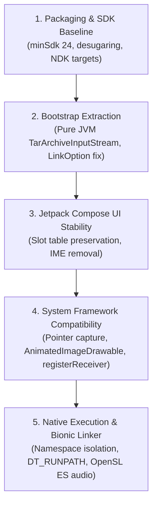

# XoDos-Ark: Android 7 (API 24+) Compatibility Changelog & Engineering Report

**Target Scope:** Android 7.0 & 7.1.2 (Nougat, API 24/25), Android 8.0 & 8.1 (Oreo, API 26/27), and Android 9.0 (Pie, API 28).  
**Verification Environment:** VMOS Pro Android 7.1.2 64-bit VM (`aarch64`), Physical Android 7.1.2 & Android 14 devices.  
**Baseline Release:** `0.6.0`  
**Current Milestone Release:** `0.6.6_10` (`versionCode = 76`)

---

## Executive Summary

To make XoDos-Ark fully operational on Android 7 (API 24/25) while preserving complete compatibility with modern Android (8 through 15), we addressed a cascading series of platform breaking points across five key layers:



Below is the exhaustive, issue-by-issue breakdown of every problem encountered, its underlying technical root cause, and the exact solution implemented.

---

## 1. Packaging, Build System & Audio Subsystem

### Issue 1.1: App Installation Blocked (`minSdk = 26`)
* **Symptom:** APK failed to install on Android 7 devices (`INSTALL_FAILED_OLDER_SDK`).
* **Root Cause:** [build.gradle.kts](file:///data/user/0/ai.antigem/files/home/XODOS-ARK/xodosark-app/app/build.gradle.kts) had `minSdk = 26` (Android 8.0 Oreo), blocking any device running Android 7 (API 24/25).
* **Solution:**
  * Lowered `minSdk` to `24`.
  * Enabled Core Library Desugaring (`isCoreLibraryDesugaringEnabled = true`) with `com.android.tools:desugar_jdk_libs_nio:2.0.4`.
  * Target compilation SDK maintained at `34` with `targetSdk = 28`.

### Issue 1.2: Dynamic Linker Failure on Missing AAudio (`libaaudio.so`)
* **Symptom:** App crashed immediately on startup on Android 7 when loading `libxodos2.so`:
  ```text
  java.lang.UnsatisfiedLinkError: dlopen failed: library "libaaudio.so" not found
  ```
* **Root Cause:** Android's AAudio API was introduced in Android 8.0 (API 26). The Rust native audio subsystem linked directly to AAudio symbols at link time, which failed dynamic linking on Android 7.
* **Solution ([audio.rs](file:///data/user/0/ai.antigem/files/home/XODOS-ARK/xodosark-native/src/android/audio.rs)):**
  * Added dynamic runtime loading of `libaaudio.so` via `libloading::Library::new("libaaudio.so")`.
  * Implemented an OpenSL ES audio fallback backend (`OpenSLAudioEngine`) for API 24/25 devices when AAudio is unavailable.
  * Reconfigured NDK Clang targets in build scripts to `aarch64-linux-android24-clang`.

---

## 2. Bootstrap Archive Extraction Engine

### Issue 2.1: Non-PIE ASLR SIGSEGV Crash During Tar Piping
* **Symptom:** Bootstrap extraction halted or crashed silently.
* **Root Cause:** The legacy extractor piped files through native command-line utilities (`pv`, `xz`, `tar`). Android 7 strictly enforces Position Independent Executables (PIE); older auxiliary binaries compiled without `-fPIE -pie` failed ASLR checks with exit code 139 (`SIGSEGV`) or `error: only position independent executables (PIE) are supported`.
* **Solution ([ArchiveUtils.kt](file:///data/user/0/ai.antigem/files/home/XODOS-ARK/xodosark-app/app/src/main/java/app/xodos2/ui/runtime/ArchiveUtils.kt)):**
  * Implemented pure Kotlin/JVM extraction using `org.apache.commons.compress.archivers.tar.TarArchiveInputStream` wrapped over `org.tukaani.xz.XZInputStream`.
  * Preserved executable permissions and relative symbolic links using `android.system.Os.symlink` and `android.system.Os.chmod`.
  * Completely eliminated external process spawning and pipe dependencies for bootstrap installation.

### Issue 2.2: `NoClassDefFoundError: java.nio.file.LinkOption` on Android 7
* **Symptom:** Archive extraction crashed immediately on Android 7:
  ```text
  java.lang.NoClassDefFoundError: Failed resolution of: Ljava/nio/file/LinkOption;
      at org.apache.commons.compress.archivers.tar.TarArchiveInputStream...
  ```
* **Root Cause:** Newer versions of `commons-compress` (1.26+) invoke Java 7/8 NIO `java.nio.file` APIs which were only introduced into the Android framework in API 26 (Android 8.0).
* **Solution:**
  * Downgraded `commons-compress` to `1.20` in [build.gradle.kts](file:///data/user/0/ai.antigem/files/home/XODOS-ARK/xodosark-app/app/build.gradle.kts) (which uses standard `java.io.File`).
  * Switched desugar dependency to `desugar_jdk_libs_nio:2.0.4` to backport necessary NIO classes safely.

### Issue 2.3: Symlink Skipping Due to Canonical Path Resolution
* **Symptom:** Essential `.so` symlinks (such as `libreadline.so.8`) were skipped or failed extraction.
* **Root Cause:** Standard Tar-Slip security checks calling `targetFile.canonicalPath` followed already existing symlinks on disk. On Android 7 VM environments where `/data/data` and `/data/user/0` canonicalize differently, `targetCanonical.startsWith(destCanonical)` falsely evaluated to `false`.
* **Solution ([ArchiveUtils.kt](file:///data/user/0/ai.antigem/files/home/XODOS-ARK/xodosark-app/app/src/main/java/app/xodos2/ui/runtime/ArchiveUtils.kt#L49-L75)):**
  * Implemented entry path normalization before filesystem inspection:
    ```kotlin
    if (entryName.contains("..") || entryName.startsWith("/")) continue
    ```
  * Checked both `targetCanonical.startsWith(destCanonical)` and `targetFile.absolutePath.startsWith(destDir.absolutePath)`.
  * Added fallback copy mechanisms if `Os.symlink` encounters filesystem restrictions.

---

## 3. Jetpack Compose UI Stability

### Issue 3.1: Compose Slot Table Collapse (`LayoutNode should be attached to an owner`)
* **Symptom:** App crashed during or right after bootstrap extraction:
  ```text
  java.lang.IllegalStateException: LayoutNode should be attached to an owner
      at androidx.compose.ui.node.LayoutNodeKt.requireOwner(LayoutNode.kt:1561)
  ```
* **Root Cause:** In [AppScreen.kt](file:///data/user/0/ai.antigem/files/home/XODOS-ARK/xodosark-app/app/src/main/java/app/xodos2/ui/AppScreen.kt), conditional early `return` statements (`if (!initialized) { ... return }`) were abruptly tearing down the active Compose slot table during state updates.
* **Solution ([AppScreen.kt](file:///data/user/0/ai.antigem/files/home/XODOS-ARK/xodosark-app/app/src/main/java/app/xodos2/ui/AppScreen.kt)):**
  * Eliminated all early returns.
  * Hosted the UI hierarchy in a single, stable root `Box(modifier = Modifier.fillMaxSize())`, keeping progress and install overlays layered on top without dismantling underlying composition trees.
  * Initialized `initialized = hasInstalledBootstrap` (`File(filesDir, "usr/bin/pkg").exists()`) so that installed systems boot straight to terminal without screen swaps.

### Issue 3.2: Legacy IME Measurement Loop Crash
* **Symptom:** Opening the soft keyboard or resizing the terminal view triggered an infinite remeasure loop leading to an unattached `LayoutNode` crash.
* **Root Cause:** `.statusBarsPadding().imePadding()` modifiers attached to the embedded `AndroidView(ShellScreen)` in Android 7 caused conflicting measurement passes during insets dispatching.
* **Solution ([ShellScreen.kt](file:///data/user/0/ai.antigem/files/home/XODOS-ARK/xodosark-app/app/src/main/java/app/xodos2/ui/shell/ShellScreen.kt)):**
  * Removed `.statusBarsPadding().imePadding()` from `AndroidView`, letting the internal terminal view manage its own window geometry via `updateSize`.

---

## 4. Android Framework & API Level Shims

### Issue 4.1: `NoClassDefFoundError: AnimatedImageDrawable`
* **Symptom:** Shell crashed on opening:
  ```text
  java.lang.NoClassDefFoundError: Failed resolution of: Landroid/graphics/drawable/AnimatedImageDrawable;
      at app.xodos2.ui.shell.AnimatedBackgroundView.onVisibilityChanged...
  ```
* **Root Cause:** `android.graphics.drawable.AnimatedImageDrawable` and `android.graphics.ImageDecoder` were introduced in Android 9 (API 28). Calling them directly caused ClassLoader failure on API 24/25/26/27.
* **Solution ([AnimatedBackgroundView.kt](file:///data/user/0/ai.antigem/files/home/XODOS-ARK/xodosark-app/app/src/main/java/app/xodos2/ui/shell/AnimatedBackgroundView.kt)):**
  * Cast animated drawables to `android.graphics.drawable.Animatable` (standard since API 1) for `start()`, `stop()`, and `isRunning`.
  * Moved `ImageDecoder` usages into an `@RequiresApi(Build.VERSION_CODES.P)` helper object with safe bitmap decoders for older versions.

### Issue 4.2: `NoClassDefFoundError: View$OnCapturedPointerListener`
* **Symptom:** Launching X11 caused an immediate crash:
  ```text
  java.lang.NoClassDefFoundError: Failed resolution of: Landroid/view/View$OnCapturedPointerListener;
      at com.termux.x11.MainActivity.setX11ConnectionListener...
  ```
* **Root Cause:** Pointer capture (`View.OnCapturedPointerListener`, `requestPointerCapture()`, `hasPointerCapture()`) and `NotificationChannel` APIs were introduced in Android 8.0 (API 26).
* **Solution ([MainActivity.java](file:///data/user/0/ai.antigem/files/home/XODOS-ARK/xodosark-app/app/src/main/java/com/termux/x11/MainActivity.java), [TouchInputHandler.java](file:///data/user/0/ai.antigem/files/home/XODOS-ARK/xodosark-app/app/src/main/java/com/termux/x11/input/TouchInputHandler.java)):**
  * Isolated all pointer capture listeners into `@RequiresApi(Build.VERSION_CODES.O) private static class Api26Helper`.
  * Guarded pointer capture requests with `Build.VERSION.SDK_INT >= Build.VERSION_CODES.O`.

### Issue 4.3: `NoSuchMethodError: registerReceiver` with 3 Arguments
* **Symptom:** X11 crashed on launch:
  ```text
  java.lang.NoSuchMethodError: No virtual method registerReceiver(Landroid/content/BroadcastReceiver;Landroid/content/IntentFilter;I)Landroid/content/Intent; in class Lcom/termux/x11/MainActivity;
      at com.termux.x11.MainActivity.onCreate(MainActivity.java:1270)
  ```
* **Root Cause:** `registerReceiver(receiver, filter, int flags)` was introduced in API 33 (Android 13). Calling `registerReceiver(..., ..., SDK_INT >= TIRAMISU ? RECEIVER_EXPORTED : 0)` resolved to the 3-argument method at compile time, causing a missing method crash on Android 7–12.
* **Solution ([MainActivity.java](file:///data/user/0/ai.antigem/files/home/XODOS-ARK/xodosark-app/app/src/main/java/com/termux/x11/MainActivity.java#L1270), [LoriePreferences.java](file:///data/user/0/ai.antigem/files/home/XODOS-ARK/xodosark-app/app/src/main/java/com/termux/x11/LoriePreferences.java#L210)):**
  * Explicitly branch by API level:
    ```java
    if (Build.VERSION.SDK_INT >= Build.VERSION_CODES.TIRAMISU) {
        registerReceiver(receiver, filter, RECEIVER_EXPORTED);
    } else {
        registerReceiver(receiver, filter);
    }
    ```

---

## 5. Native Shell & Bionic Linker Namespace Architecture

### Issue 5.1: `CANNOT LINK EXECUTABLE ... library "libreadline.so.8" not found`
* **Symptom:** Terminal initialized, displayed welcome banner, but failed immediately with:
  ```text
  CANNOT LINK EXECUTABLE "/data/user/0/app.xodos2/files/usr/bin/bash": library "libreadline.so.8" not found
  ```
* **Root Cause:**
  1. Bootstrap packages are precompiled with `DT_RUNPATH = [/data/data/app.xodos2/files/usr/lib]`.
  2. In Android 7.0 (API 24), Android's Bionic dynamic linker introduced **Linker Namespaces**. When `bash` was executed as `/data/user/0/app.xodos2/files/usr/bin/bash`, the linker created an isolated namespace rooted at `/data/user/0/` and rejected searching the hardcoded `DT_RUNPATH` `/data/data/...` due to the prefix mismatch.
  3. Across `execve()`, the Bionic linker stripped or ignored `LD_LIBRARY_PATH` for security.
  4. In virtual environments like VMOS Pro, `/data/data/app.xodos2` was not automatically symlinked to `/data/user/0/app.xodos2`.
* **Solution:**
  * **[proot.rs](file:///data/user/0/ai.antigem/files/home/XODOS-ARK/xodosark-native/src/android/proot.rs#L505-L545):** In `build_native_args()`, prefer `/data/data/app.xodos2/files/usr/bin/bash` if present so that the binary execution path matches its internal `DT_RUNPATH`.
  * Expanded `LD_LIBRARY_PATH` and `PATH` to include `/data/data/...`, `/data/user/0/...`, `/system/lib64`, and `/vendor/lib64`.
  * **[NativeInstallCoordinator.kt](file:///data/user/0/ai.antigem/files/home/XODOS-ARK/xodosark-app/app/src/main/java/app/xodos2/ui/runtime/NativeInstallCoordinator.kt#L1445):** In `setupNativeEnvironment()`, dynamically create a bidirectional symlink `/data/data/app.xodos2 <-> /data/user/0/app.xodos2`.
  * Added automated integrity repair in `usr/lib` on startup: if `libreadline.so.8` or `libhistory.so.8` is missing or broken, automatically recreate the symlink or copy from the underlying `.8.3` binaries.

### Issue 5.2: Premature Session Failure Lock on First Boot
* **Symptom:** First launch immediately showed in red:
  ```text
  Failed to start session. Check container installation.
  ```
* **Root Cause:** In [RustPtySession.kt](file:///data/user/0/ai.antigem/files/home/XODOS-ARK/xodosark-app/app/src/main/java/app/xodos2/RustPtySession.kt#L64), `spawnAttempted = true` was locked unconditionally. On first boot, Compose rendered the terminal milliseconds before `NativeBridge.init()` finished, permanently bricking that session until a restart.
* **Solution ([RustPtySession.kt](file:///data/user/0/ai.antigem/files/home/XODOS-ARK/xodosark-app/app/src/main/java/app/xodos2/RustPtySession.kt#L64)):**
  * `spawnAttempted = true` is now set only when `spawnSessionInRootfs` returns `true`. If the native bridge is still initializing, it logs a warning and retries on the next layout pass.

### Issue 5.3: User Data Retention Guarantee Across App Updates
* **Requirement:** Updating the app must never wipe user packages, PRoot containers, or data.
* **Verification & Architecture:**
  * In Android, updating an existing APK preserves `/data/data` and `/data/user/0`.
  * [NativeInstallCoordinator.kt](file:///data/user/0/ai.antigem/files/home/XODOS-ARK/xodosark-app/app/src/main/java/app/xodos2/ui/runtime/NativeInstallCoordinator.kt#L1345) explicitly gates bootstrap extraction behind `if (!pkgFile.exists())`.
  * Containers and user directories (`files/containers/*`, `files/home/*`) remain untouched across updates.

---

## 6. Summary of Changed Files

| File | Purpose |
| :--- | :--- |
| [xodosark-app/app/build.gradle.kts](file:///data/user/0/ai.antigem/files/home/XODOS-ARK/xodosark-app/app/build.gradle.kts) | Lower `minSdk = 24`, enable desugaring, set version `0.6.6_10`. |
| [MainActivity.java](file:///data/user/0/ai.antigem/files/home/XODOS-ARK/xodosark-app/app/src/main/java/com/termux/x11/MainActivity.java) | Isolate `Api26Helper` (captured pointer, notification channel), fix `registerReceiver`. |
| [LoriePreferences.java](file:///data/user/0/ai.antigem/files/home/XODOS-ARK/xodosark-app/app/src/main/java/com/termux/x11/LoriePreferences.java) | Guard 3-argument `registerReceiver` behind `VERSION_CODES.TIRAMISU`. |
| [ArchiveUtils.kt](file:///data/user/0/ai.antigem/files/home/XODOS-ARK/xodosark-app/app/src/main/java/app/xodos2/ui/runtime/ArchiveUtils.kt) | Pure JVM Tar/XZ extractor, Zip Slip entry checks, symlink fallbacks. |
| [NativeInstallCoordinator.kt](file:///data/user/0/ai.antigem/files/home/XODOS-ARK/xodosark-app/app/src/main/java/app/xodos2/ui/runtime/NativeInstallCoordinator.kt) | Path symlinking (`/data/data <-> /data/user/0`), verify `.so` symlinks in `usr/lib`. |
| [RustPtySession.kt](file:///data/user/0/ai.antigem/files/home/XODOS-ARK/xodosark-app/app/src/main/java/app/xodos2/RustPtySession.kt) | Non-blocking retry on initial session spawn. |
| [AnimatedBackgroundView.kt](file:///data/user/0/ai.antigem/files/home/XODOS-ARK/xodosark-app/app/src/main/java/app/xodos2/ui/shell/AnimatedBackgroundView.kt) | Replace `AnimatedImageDrawable` with `Animatable`, isolate `ImageDecoder`. |
| [AppScreen.kt](file:///data/user/0/ai.antigem/files/home/XODOS-ARK/xodosark-app/app/src/main/java/app/xodos2/ui/AppScreen.kt) | Remove early returns, stable root `Box`, startup bootstrap check. |
| [ShellScreen.kt](file:///data/user/0/ai.antigem/files/home/XODOS-ARK/xodosark-app/app/src/main/java/app/xodos2/ui/shell/ShellScreen.kt) | Remove `imePadding` from `AndroidView` to fix measurement loop. |
| [proot.rs](file:///data/user/0/ai.antigem/files/home/XODOS-ARK/xodosark-native/src/android/proot.rs) | Linker namespace path alignment, remove `linker64` from argv, dual LD paths. |
| [audio.rs](file:///data/user/0/ai.antigem/files/home/XODOS-ARK/xodosark-native/src/android/audio.rs) | Dynamic AAudio loading with OpenSL ES fallback for Android 7. |
